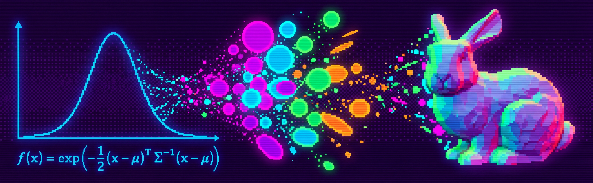

# Gaussian Splatting Course

---



---

**[EN English](README.md)**

## О чём

Gaussian Splatting — способ восстановить по фотографиям представление 3D-сцены и получать изображения с новых ракурсов. Качество зависит от исходных наблюдений; невидимые на всех фотографиях поверхности достоверно восстановить нельзя. Метод 3DGS 2023 года сделал возможным качественный рендеринг таких сцен в реальном времени на подходящем оборудовании.

Этот курс объясняет, как работает этот метод. Изнутри. От математики одного элемента до запуска на GPU.

---

## Зачем я это сделал

Я начал разбираться в Gaussian Splatting и быстро понял: свободно читать статьи не получается. Слишком много матана, слишком мало примеров. Мне нужны аналогии, конкретные числа, код — а не формулы на полстраницы без объяснения, что они значат.

Бесплатного нормального курса, который бы провёл от нуля до понимания — я не нашёл. В платном сегменте буквально пару курсов сомнительного содержания. Поэтому начал собирать свой. Такой, какой был бы понятен мне самому с первого дня. Разбираюсь в теме, проверяю на примерах, структурирую и пишу.

Курс растёт вместе со мной.

---

## Для кого

Для инженеров, энтузиастов и всех желающих, которые пишут код и хотят понять, как это устроено.

Я не математик. Я CV/3D-инженер. Если я разобрался — разберёшься и ты.

---

## Что нужно знать заранее

- **Python** — уметь читать и менять небольшой скрипт, работать с функциями, циклами и массивами.
- **PyTorch** — знакомство с тензорами полезно. Нужные операции повторим на примерах; autograd и цикл обучения разберём в курсе.
- **Математика** — достаточно обычной арифметики. Векторы, матрицы, производные и остальные необходимые понятия вводятся перед использованием, с рисунками и конкретными числами.

Перед первым блоком — подготовка окружения, запуск готового примера и знакомство с управлением экспериментами. Для каждого практического задания будут указаны зависимости, требования к оборудованию и ожидаемый результат.

---

## Как устроено обучение

**Наглядность → практика → конкретные числа → математика по шагам → код → проверка понимания.**

Сначала смотрим на результат и пробуем его изменить. Затем разбираем, почему он меняется. Математика объясняет уже наблюдаемое поведение.

Каждая используемая формула разбирается по косточкам:

1. Какую задачу она решает и откуда берётся.
2. Как читается каждый символ; какие величины на входе и выходе, каковы их размерности и допустимые значения.
3. Зачем нужна каждая операция и в каком порядке она выполняется.
4. Полный расчёт на конкретных числах, без пропущенных промежуточных шагов.
5. Что означает результат на графике, изображении или в сцене.
6. Как изменение одного параметра влияет на результат и что происходит в граничных случаях.
7. Как каждому шагу соответствует код.

Новые понятия — экспонента, дисперсия, обратная матрица, производная, якобиан — получают собственное объяснение до того, как понадобятся в большой формуле. Аналогию проверяем числами и показываем, где она перестаёт работать. Упрощения и приближения обозначаем явно.

Практика есть в каждом уроке: интерактивный эксперимент или запускаемый пример с изменяемыми параметрами. В конце — задание сначала предсказать изменение картинки, затем проверить предположение и объяснить результат.

---

## Доступные материалы

| Урок | Читать на GitHub | Практика в Jupyter |
|---|---|---|
| 01 | [Что такое Gaussian Splatting и какую задачу он решает](lessons/ru/lesson-01.md) | [Ноутбук с исследованием сцены](notebooks/ru/lesson-01.ipynb) |
| 02 | [Одна гауссиана на прямой: разбираем колокол](lessons/ru/lesson-02.md) | [Ноутбук с графиками и расчётами](notebooks/ru/lesson-02.ipynb) |

Ноутбуки содержат полный текст уроков, код, графики и интерактивные задания. Версии для чтения сохраняют текст, код и статические результаты. На GitHub ползунки не работают — для практики открой ноутбук в Jupyter.

### Запуск практики

Скачай и распакуй весь репозиторий: ноутбукам нужен общий модуль `course_demos.py`. Для первых двух уроков достаточно CPU и Python 3.11 или новее; GPU, PyTorch и аккаунты внешних сервисов не нужны. Интернет нужен для первоначальной установки зависимостей и дополнительных ссылок на исследования.

Открой терминал в папке курса. Создай отдельное окружение:

```text
python -m venv .venv
```

В Windows PowerShell:

```powershell
.\.venv\Scripts\python.exe -m pip install -r requirements.txt
.\.venv\Scripts\python.exe -m jupyterlab
```

В macOS или Linux:

```sh
.venv/bin/python -m pip install -r requirements.txt
.venv/bin/python -m jupyterlab
```

Если Jupyter уже настроен через Anaconda, можно установить зависимости в выбранное окружение и запустить Jupyter из него. Сервер и ядро Python должны использовать окружение с установленными зависимостями.

В Jupyter открой `notebooks/ru/lesson-01.ipynb`. Выбери **Kernel → Restart Kernel and Run All Cells**. Дождись выполнения, затем меняй параметры. Тяжёлый пример сцены обновляется после отпускания ползунка. Кнопка сброса возвращает исходные настройки.

Если вместо ползунков видна строка вроде `VBox(...)`, проверь установку `ipywidgets` в окружении ядра и перезапусти Jupyter. Все ячейки также можно запускать по очереди сочетанием **Shift+Enter**.

Тексты уроков редактируются в ноутбуках. Команда `python scripts/build_lessons.py` заново выполняет четыре ноутбука и обновляет Markdown-версии вместе с рисунками.

---

## Программа курса

Шесть блоков, 30 небольших уроков и три сквозных проекта: **восстановление изображения → статическая 3D-сцена → динамическая сцена**. Последний блок посвящён их размеру, скорости и сжатию.

Это план развития курса; доступные тексты перечислены выше. Каждый следующий блок использует результаты предыдущих.

### Блок 1. Как из гауссиан получается изображение

Знакомимся с одной гауссианой, учимся управлять её формой и собирать изображение из нескольких пятен.

| № | Урок | Практика и наблюдаемый результат |
|---|---|---|
| 01 | Что такое Gaussian Splatting и какую задачу он решает | Рассматриваем готовую сцену: центры, отдельные гауссианы и итоговая картинка. Сопоставляем результат с исходными фотографиями и исследуем ограничения, включая поверхности, которых нет ни на одном снимке. |
| 02 | Одна гауссиана на прямой: разбираем колокол | Двигаем центр и меняем ширину. Строим формулу из вычитания, деления, квадрата и экспоненты; связываем каждую операцию с графиком. |
| 03 | Гауссиана на плоскости: от колокола к пятну | Рассматриваем одну функцию как тепловую карту, холм и линии одинакового значения. Превращаем круг в эллипс. |
| 04 | Форма и поворот: зачем нужна ковариационная матрица | Поворачиваем эллипс и следим за числами в матрице. Разбираем масштаб, дисперсию, ковариацию и обратную матрицу; вычисляем значения в выбранных точках. |
| 05 | Несколько пятен: цвет, непрозрачность и перекрытия | Собираем простую картинку. Меняем порядок двух цветных пятен и вручную рассчитываем цвет выбранного пикселя. |

**Результат:** небольшой редактор гауссиан на плоскости. Каждый параметр связан с понятным изменением изображения.

### Блок 2. Как гауссианы учатся

Постепенно заменяем ручную настройку автоматической и восстанавливаем выбранное изображение.

| № | Урок | Практика и наблюдаемый результат |
|---|---|---|
| 06 | Как измерить ошибку изображения | Сравниваем образец и результат, строим карту различий. Рассчитываем простые функции ошибки на нескольких пикселях. |
| 07 | Производная и градиент: куда двигать параметр | Вручную подгоняем одно пятно, строим график ошибки и связываем наклон с направлением изменения. Проверяем влияние размера шага. |
| 08 | Автоматическое дифференцирование и первый цикл обучения | Проходим цепочку «параметр → изображение → ошибка → градиент → обновление». Разбираем правило цепочки на числах и сравниваем численную проверку градиента с PyTorch. |
| 09 | Восстанавливаем картинку набором гауссиан | Обучаем десятки и сотни пятен. Сравниваем начальные положения, размеры и количество элементов; наблюдаем, где не хватает деталей. |

**Результат:** программа постепенно восстанавливает выбранную картинку, а каждый шаг обучения можно объяснить.

Этот учебный проект называется **восстановлением изображения гауссианами**. Он не является реализацией отдельного метода 2D Gaussian Splatting для реконструкции поверхностей в 3D.

### Блок 3. Как трёхмерная сцена становится картинкой

Добавляем пространство и камеру. Разделяем движение объекта, движение камеры и изменение изображения.

| № | Урок | Практика и наблюдаемый результат |
|---|---|---|
| 10 | Координаты и преобразования в 3D | Двигаем точку и объект, поворачиваем систему координат. Разбираем векторы, умножение матриц и переход между координатами мира и камеры. |
| 11 | Как работает камера и перспектива | Меняем положение камеры и фокусное расстояние. На нескольких точках вычисляем координаты пикселей и объясняем, почему дальние объекты меньше. |
| 12 | Гауссиана в 3D: форма, масштаб и поворот | Превращаем шар в эллипсоид. Разбираем матрицу поворота, ось и угол, затем кватернион, его формулы и нормировку; проверяем ограничения параметров формы. |
| 13 | Проекция гауссианы: из объёма в пятно | Рассматриваем эллипсоид с разных сторон. Проецируем центр и форму; разбираем якобиан через локальные изменения и проверяем границы применимости приближения. |
| 14 | Рендеринг сцены: глубина, видимость и смешивание | Собираем сцену из нескольких гауссиан. Наблюдаем ошибки порядка перекрытий и прослеживаем получение итогового кадра. |
| 15 | Почему цвет меняется с направлением взгляда | Сравниваем постоянный цвет с зависимостью от ракурса. Постепенно вводим сферические гармоники и показываем вклад отдельных функций и коэффициентов. |

**Результат:** собственный учебный 3D-рендерер с движущейся камерой и возможностью исследовать отдельные гауссианы.

### Блок 4. Полноценный статический Gaussian Splatting

Соединяем обучение и рендеринг, затем переходим от контролируемых примеров к собственным фотографиям.

| № | Урок | Практика и наблюдаемый результат |
|---|---|---|
| 16 | Обучение 3D-сцены по нескольким изображениям | Начинаем с простой сцены с известными камерами. Проверяем, почему совпадения с одной картинкой недостаточно и как дополнительные ракурсы ограничивают решение. |
| 17 | Как модель меняет количество гауссиан | Разбираем клонирование, разделение, удаление и сброс непрозрачности. Отделяем эти операции от градиентного обновления параметров; наблюдаем изменения качества и памяти. |
| 18 | Оригинальная статья и устройство быстрой реализации | Сопоставляем знакомые части с работой Kerbl et al. Разбираем разбиение экрана на участки, отбрасывание лишнего и обработку на GPU. Сравниваем учебную и быструю реализации. |
| 19 | Подготовка данных: съёмка, камеры и COLMAP | Проходим путь от фотографий до параметров камер и начального облака точек. Исследуем последствия плохого покрытия, смаза и ошибок восстановления камер. |
| 20 | Первая собственная сцена | Готовим небольшой набор данных, обучаем модель, сохраняем результат и открываем его в просмотрщике. |
| 21 | Как оценивать качество и находить причины артефактов | Проверяем сцену на отложенных ракурсах. Разбираем плавающие пятна, размытие, мерцание и ошибки цвета. Объясняем метрики на изображениях и числах; измеряем скорость и память. |

**Результат:** собственная статическая сцена и понимание того, как различать проблемы данных, модели и рендеринга. После этого блока можно самостоятельно работать со статическим GS.

### Блок 5. Динамические сцены: добавляем время

Начинаем с одного движущегося элемента, затем изучаем разные способы представления динамики.

| № | Урок | Практика и наблюдаемый результат |
|---|---|---|
| 22 | Что меняется, когда сцена движется | Сравниваем движение камеры и объекта. Разбираем данные одной и нескольких синхронизированных камер, перекрытия и недостаток наблюдений в пространстве и времени. |
| 23 | Одна гауссиана во времени | Задаём траекторию, поворот и изменение формы. Учимся восстанавливать простое движение; сравниваем интерполяцию с предсказанием за пределами наблюдений. |
| 24 | Сохраняющиеся гауссианы: Dynamic 3D Gaussians | Прослеживаем одни и те же элементы между кадрами. Разбираем подход Luiten et al., ограничения движения и согласованность соседних частей на небольшом примере. |
| 25 | Исходная сцена и её деформация: 4D-GS | Показываем, как из общей исходной сцены получается состояние в выбранный момент. Разбираем подход Wu et al.: представление пространства и времени и предсказание деформаций. |
| 26 | Собственная простая динамическая модель | Реализуем выбранный подход на небольшой сцене. Проверяем новые ракурсы, промежуточные моменты времени и устойчивость движения. |

**Результат:** небольшая динамическая сцена, в которой можно независимо менять время и положение камеры.

### Блок 6. Размер, скорость и сжатие

Используем знакомые сцены и для каждого изменения измеряем выигрыш и потери.

| № | Урок | Практика и наблюдаемый результат |
|---|---|---|
| 27 | Из чего складываются размер файла и расход памяти | Считаем стоимость позиции, формы, цвета и непрозрачности. Разделяем размер сохранённой модели, память при просмотре и память при обучении. |
| 28 | Сжатие статической сцены | Проверяем удаление малополезных элементов, уменьшение точности чисел и упрощение представления цвета. Сравниваем изображения, размер и скорость до и после. |
| 29 | Сжатие динамики | Исследуем повторения между моментами времени и способы хранения изменений. Сравниваем качество движения, размер и время декодирования. |
| 30 | Итоговый эксперимент и выбор метода под задачу | Готовим несколько вариантов одной сцены. Сравниваем качество, размер, скорость и требования к оборудованию; обосновываем выбор и сохраняем настройки для повторения эксперимента. |

**Результат:** сцена с измеренными характеристиками и воспроизводимый эксперимент по её оптимизации.

### Дополнительные материалы

Отдельно от основного маршрута: обзор экосистемы и актуальных статей, восстановление поверхностей и мешей, метод 2DGS, углублённое программирование GPU. Эти темы подключаются под конкретную задачу.

---

## Как проходить

По порядку, с запуском примеров. Каждый блок опирается на предыдущий и заканчивается работающим результатом.

Не нужно запоминать формулу до того, как стал понятен её смысл. Если обозначение или операция непонятны, возвращаемся к конкретным числам и картинке, разбираем недостающий шаг и только затем двигаемся дальше.

В экспериментах сначала меняй один параметр. Предскажи, что произойдёт, проверь и объясни отличие от ожиданий. Затем сочетай изменения. Сохраняй промежуточные результаты: они понадобятся для сравнения качества, скорости и размера.

---

## Автор

**Heinrich Wirth**

[@wirth_heinrich](https://x.com/wirth_heinrich)

---

## Лицензия

MIT.
