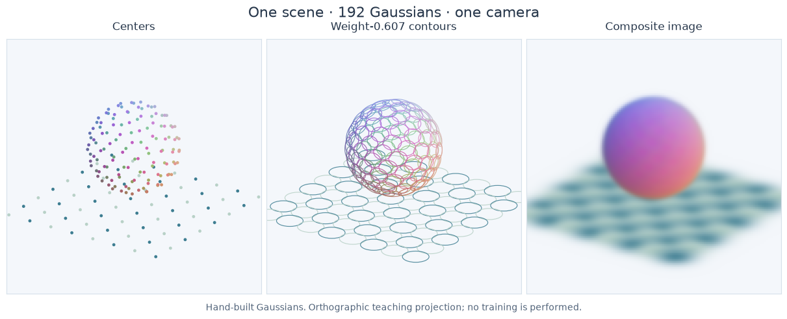
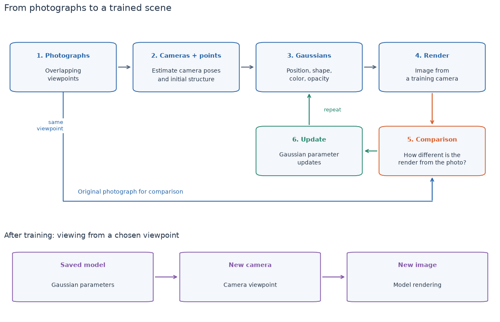
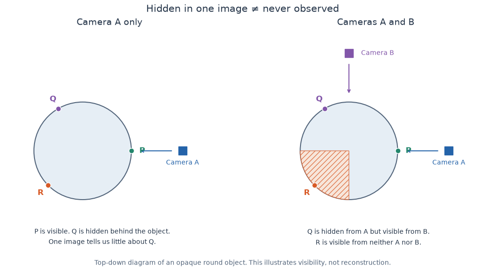

[Open the Jupyter notebook](../../notebooks/en/lesson-01.ipynb)

Sliders work in a running Jupyter session. This page preserves the text, code, and static results.


# Lesson 1. What Gaussian Splatting Is and What Problem It Solves

[Course plan](../../README.md) · [Русский](../ru/lesson-01.md) · [Next lesson: one Gaussian on a line](lesson-02-en.md)

You photograph an object from several sides. Now you want to see it from a position where the camera **never stood**. How could you produce that image?

In this lesson, we first explore a small scene and look inside its representation. Then we follow the path from photographs to a result. By the end, you will be able to explain:

- how a photograph differs from a scene representation;
- what one Gaussian stores and why a scene needs many of them;
- how training differs from viewing a finished model;
- why a new viewpoint does not imply knowledge of an unseen side of an object.

You do not need matrices or derivatives yet. First, we need observations. The mathematical breakdown of one soft spot begins in lesson 2.

## 1. Look first

Below is a **synthetic teaching scene**: a colored sphere above a plane. It contains 192 Gaussians: 128 on the sphere and 64 on the plane. Their positions, shapes, and colors are specified by the program. This scene **was not trained from photographs**.

These first experiments use an orthographic camera: parallel projection directions let us examine shape without distant objects becoming smaller through perspective. This is a simplified teaching viewer; perspective cameras and full rendering come later. Overlap order is determined by center depth, so this approximation can give incorrect results for complex intersections.

If you are reading on GitHub, the static figures already show the main states. To use the sliders, open this notebook in Jupyter using the [setup instructions](../../README.md), then run the cells in order. **Run All** runs every cell. The first block finds the course folder and imports the visualization tools; you do not need to study its implementation yet.

```python
%matplotlib inline
from pathlib import Path
import sys
from IPython.display import display

course_root = next(
    (folder for folder in [Path.cwd(), *Path.cwd().parents]
     if (folder / "course_demos.py").is_file()),
    None,
)
if course_root is None:
    raise FileNotFoundError(
        "Open this notebook from inside the downloaded course folder."
    )
if str(course_root) not in sys.path:
    sys.path.insert(0, str(course_root))

from course_demos import scene_overview, scene_lab, coverage_figure, pipeline_figure
LANG = "en"
```

```python
display(scene_overview(language=LANG))
```



The three images show **the same data from the same viewpoint**:

| Mode | What is shown | What to look for |
|---|---|---|
| **Centers** | Only the position of each Gaussian | Gaps remain between individual points. Their extent and softness are not displayed yet. |
| **Contours** | A line at a selected influence level for each Gaussian | Size and orientation become visible. This is not a hard boundary: influence continues beyond the line. |
| **Composite image** | Soft colored footprints with overlap | Several elements together produce a more continuous image. |

In this viewer, a contour follows the locations where a spot's weight is approximately **61% of its weight at the center**. The same level is used for every Gaussian so that their shapes can be compared. We will explain what this weight means and how to calculate it in the next lesson.

The centers do not disappear from the model when you switch to the composite. Only the way we display the same collection of numbers changes.

```python
display(scene_lab(language=LANG))
```

## 2. Five experiments before the explanation

Predict what will happen first. Then change a control and compare the result with your expectation.

1. **Switch between the three modes while keeping the viewpoint.** Find a part of the plane with visible gaps in Centers mode. Inspect it in Composite image mode. The footprints do not add new centers; they distribute influence around the existing ones.
2. **Change Camera orbit and View elevation.** The first slider moves the camera around the scene; the second changes whether you look from above or from the side. The plane looks wide from one direction and narrow from another. The image changes while the scene stays the same.
3. **Select one Gaussian by its index and enable isolation.** An index is simply an element's number in a list. It does not inherently mean “chair,” “wall,” or “sphere.” Inspect the selected element in Contours mode and then in Composite image mode.
4. **Change the selected Gaussian's opacity.** In Composite image mode, compare 0, about 0.5, and 1. At zero, its color contribution disappears. Increasing the value makes it influence the image more strongly. Its center marker remains in Centers mode: that marker shows an element in the data, not its visible contribution.
5. **Disable isolation and reset the scene.** A change to one element may be hard to notice among the others. Reset restores the initial parameters and view so you can repeat the comparison.

**The important observation:** moving the camera does not create a new scene from scratch. The program computes another view of the same elements. No training takes place in this experiment.

## 3. What problem are we solving?

A photograph is a flat grid of colored pixels. A pixel gives a color at one location **in that image**. It does not contain a ready-made answer to what a camera would see after moving one step to the left.

A **scene representation** stores data from which images can be computed for different cameras. **Rendering** is the computation of an image from those data and a chosen camera. **Novel-view synthesis** means producing an image from a camera position absent from the input photographs.

Imagine a mug on a table. In a front photograph, its handle appears on the right. After walking around the table, the handle may appear on the left or become hidden behind the body. Simply stretching the original photograph does not tell us how overlaps should change or what was behind the object.

Gaussian Splatting stores a scene as a collection of adjustable Gaussians. A renderer combines them into an image from a chosen viewpoint. During reconstruction, their parameters are fitted so that views from the input cameras resemble the input photographs.

However, “resembles the photographs” and “an exact model of the entire physical scene” are different requirements. Keep that distinction in mind: it will explain the limitations discussed in the section on unseen sides.

## 4. What does one Gaussian store?

A useful first analogy is a soft spot of paint: it has a location, size, color, and contribution strength. In 3D, it is a spatial distribution of influence that produces a footprint on the screen when projected. It is **not a drop of liquid or a hard shell**: the analogy helps us imagine softness, but does not define a physical material.

Let us examine four groups of properties. The Sphere and Plane labels in the selected-element card are assigned manually by the teaching scene’s author. They do not mean that an algorithm recognized these objects.

The numbers below are separate simple examples, not the values of the currently selected element in the viewer.

### Position: where the center is

A plane needs two coordinates; space needs three. For example, position **(0, 0, 1)** in our experiment's coordinate system means zero displacement along both directions of the plane and a height of 1 above it. Here, the vertical direction is called **z**. Other programs may use different axis conventions. The coordinate unit here is arbitrary; it does not necessarily represent a meter.

The center is where the Gaussian has its greatest weight. Changing the position moves the entire distribution with it.

### Shape: how widely influence spreads, and in which directions

Compare a small ball with a flattened balloon. The latter can spread influence widely along a surface and narrowly across it. Rotation changes the directions of elongation.

For example, scales **(0.2, 0.2, 0.2)** specify equal scale along three local directions. Increasing the first to **0.4** makes the distribution wider in that direction. These numbers do not define a hard outer boundary: influence fades gradually rather than stopping abruptly.

Lesson 2 explains the meaning of one scale on a line. We then build a shape on a plane before returning to the spatial case.

### Color: what the element contributes

Our simple example uses three **RGB** components: red, green, and blue. With values from 0 to 1, **(1, 0, 0)** is red, **(0, 1, 0)** is green, and **(1, 1, 1)** is white.

Each element in our teaching scene has a constant color. In full 3DGS, color can depend on viewing direction, helping represent changes in visible color when moving around shiny objects. We will examine that color representation separately in lesson 15.

### Opacity: how strongly the element affects the image

The opacity parameter lies between **0 and 1**. At 0, the element makes no color contribution; larger values give it a stronger contribution.

Importantly, **a value of 1 does not turn the entire footprint into an opaque plate**. Influence varies across the footprint: stronger near the center, weaker farther away. The result also depends on other elements and their overlap order.

We call this parameter **opacity**, because increasing it strengthens the contribution. Calling it transparency would reverse the meaning of the control.

## 5. Why use many elements?

One Gaussian makes a soft contribution. Several well-placed elements can jointly describe a color transition, an edge, or a surface region. In our scene, the sphere consists of many elements, but no individual element inherently knows that it is “part of a sphere.”

Compare these two statements:

- **“We added more elements.”** The model now has more adjustable parameters for describing an image.
- **“The image became more accurate.”** That requires suitable placement and adjustment of those parameters, sufficient observations, and a working training procedure.

The first does not guarantee the second. A million randomly placed Gaussians do not automatically become an accurate room. There is no fixed count above which every scene becomes photorealistic.

Isolate one element, then restore the whole scene. This experiment demonstrates their combined contribution. It does **not yet demonstrate** how training finds the necessary positions and shapes: that is the subject of the next course block.

## 6. From photographs to a finished model

Our viewer starts with predefined parameters. Reconstructing a real scene requires finding them. For a basic photographic workflow, it helps to distinguish the following stages.

```python
display(pipeline_figure(language=LANG))
```



| Stage | Input | Result |
|---|---|---|
| **Capture** | A static scene and a camera | Overlapping photographs from different positions |
| **Camera and point reconstruction** | Photographs containing shared visible details | Estimated camera parameters and a sparse point cloud; COLMAP is often used for this |
| **Gaussian initialization** | Initial points and associated information | An initial collection of Gaussians |
| **Training** | Gaussians, cameras, and input images | Parameters whose rendered images agree more closely with the photographs |
| **Viewing** | A saved model and a chosen camera | An image from the requested viewpoint |

Camera positions are also estimated; they are not magically known. Errors in camera reconstruction can hinder subsequent training.

### What happens during training?

Consider one input photograph. We place a virtual camera at its corresponding position and render the current model. We compare the result with the photograph: where does the color match, where is the object misplaced, and where is detail missing?

The algorithm then changes parameters to reduce a chosen error measure. Another viewpoint is selected, and the comparison repeats. Basic 3DGS also adds and removes Gaussians during training. Changing their count and adjusting their parameters are related but distinct operations.

For now, understand **what is compared and what is changed**. In lessons 6–9, we will measure error ourselves and work through an update numerically. Full 3D training and changes to the element count appear in lessons 16–17.

### Training and viewing are different jobs

Training requires input images and repeated comparisons. When viewing a saved model, the renderer computes each frame using parameters that have already been found. Training time and viewing speed must therefore be evaluated separately.

The [original 3DGS project's results](https://repo-sam.inria.fr/fungraph/3d-gaussian-splatting/) show real reconstructions and comparisons with reference images. This is a separate example of the method in use; our local sphere and plane remain a manually specified teaching scene.

**Optional experiment with a real reconstruction (internet required).** Open Visual Comparisons on the project page. Compare Ours and Ground Truth for the same viewpoint. Identify one matching detail and one visible difference: an edge, a fine texture, or a highlight. Ground Truth is a reference image for comparison; do not assume that this particular frame was used for training. This supplements the local exercises and is not required to complete the lesson.

## 7. A new viewpoint and an unseen side are different things

Look at the top-down diagram. Cameras observe an object from different directions. The diagram illustrates visibility only: it **does not simulate training or demonstrate reconstruction quality**.

```python
display(coverage_figure(language=LANG))
```



There are three situations:

1. **A region is visible to camera A.** Image A contains an observation of that region.
2. **A region is hidden from A but visible to camera B.** One photograph lacks information that another may supply.
3. **A region is hidden from both cameras.** These observations contain no direct evidence of its appearance.

A concrete example: two boxes have identical fronts. The first has a red back; the second has a blue back. If all photographs show only the front and never reveal the back through a reflection, those photographs alone do not tell us its color.

An algorithm may still produce a result, but that is not yet a verified recovery of the hidden side. Checking it requires additional observations or assumptions that supply information from elsewhere.

This does not mean every novel view is poor. A new viewpoint can reveal a surface that was already well observed in other photographs. Problems arise when observations are insufficient or inconsistent.

Our manually specified sphere is known to the program on every side. Freely orbiting it therefore **does not prove** that the method has learned to recover surfaces that were never photographed.

## 8. How does this differ from other representations?

We can now connect the comparison to a familiar question: **what is stored, and how does it become an image?**

| Representation | What it stores | What to remember |
|---|---|---|
| **Polygon mesh** | Vertices and faces, usually with materials or textures | Useful for explicit surfaces, editing, and interaction. It can be created by an artist or reconstructed from images. |
| **Voxels** | Values in cells of a three-dimensional grid | A straightforward way to store spatial data. A dense grid grows quickly as resolution increases; sparse representations also exist. |
| **Point cloud** | Point coordinates and possibly color or other attributes | Useful for measurements and initial geometric information. How points are displayed is a separate choice. |
| **NeRF and related methods** | In the original NeRF, density depends on position; color also depends on viewing direction | The original NeRF uses a neural network; other methods change the representation and computation. Speed depends on the particular method and implementation. |
| **Gaussian Splatting** | A collection of Gaussians with adjustable parameters | Explicit elements are projected and blended. Individual elements can be inspected, but their connection to an entire object is not assigned automatically. |

Each row has variants and limitations. For example, [Instant-NGP](https://nvlabs.github.io/instant-ngp/) demonstrates why “every NeRF is always slow” is not a suitable description of the whole family.

The original 3DGS work demonstrated high quality and fast rendering in its experiments. That does not promise identical quality or frame rates on every computer and scene. Data, implementation, image resolution, and the amount of work per frame all affect the result.

For this course, the central benefit of an explicit collection of Gaussians is that we can **inspect the elements and connect parameter changes to the image**. We will use that throughout our learning.

## 9. Check your understanding

Answer in your own words first, then open the explanation. If the result differs from your expectation, revisit the relevant experiment.

### Exercise 1. What did the switch change?

You switch from Centers to Composite image without moving the camera. Fewer gaps are visible in the image. Were new points added to the data?

<details>
<summary>Worked answer</summary>

No. The same collection of 192 elements is used. Centers mode shows only each element's position. In Composite image mode, the renderer also uses shape, color, and opacity, so contributions spread around their centers and overlap. The display of the data changed, not the number of elements.

</details>

### Exercise 2. Why does an element not disappear in every mode?

Isolate one Gaussian and set its opacity to 0. Its color contribution disappears in Composite image mode. Why can Centers mode still show its point?

<details>
<summary>Worked answer</summary>

Opacity controls the contribution to the image. It does not delete the element's entry from the list. Centers mode is a diagnostic view of the data: it can display the position of an element even when that element contributes nothing. Removing its entry would require a separate deletion operation.

</details>

### Exercise 3. Are front photographs enough?

Every photograph shows only the front of a box. The resulting model shows a blue back. Can we consider that color reliably recovered?

<details>
<summary>Worked answer</summary>

No, if the back was never observed and no additional information about it is available. Red and blue backs could have produced the same input images. We need an observation from behind or an explicitly stated assumption about the color. The renderer's ability to display a back does not establish that the result is correct.

</details>

### Exercise 4. What is needed for the next frame?

The model has already been trained and saved. You rotate the camera slightly. Must all Gaussians be fitted to the input photographs again?

<details>
<summary>Worked answer</summary>

Not during ordinary viewing. The renderer takes the saved parameters and the new camera and computes an image. It is a new frame, not a new training procedure. If the model poorly describes the requested view, rotating the camera does not by itself fix its parameters.

</details>

### Exercise 5. Are more elements always better?

A thousand random Gaussians are added to a model. Does it necessarily reproduce the input photographs more accurately now?

<details>
<summary>Worked answer</summary>

No. The new elements provide extra parameters, but those parameters need suitable values. Random positions and colors can make the image worse and increase rendering cost. Improvement must be checked against observations, including viewpoints held out for evaluation.

</details>

## 10. What to take away

- A **scene model** stores parameters. A **renderer** turns them into an image for a chosen camera.
- A Gaussian has a position, shape, color, and opacity. Its soft contribution spreads around its center.
- The same elements can be displayed as centers, contours, or a composite. A contour is not a hard boundary.
- Reconstruction fits parameters to observations. Viewing uses the model that has already been found.
- Observations from other viewpoints can reveal hidden regions. A surface absent from every observation may have no reliably determined answer.

We now have a concrete question: **how can we describe influence fading away from a center using numbers?** In [lesson 2](lesson-02-en.md), we start on a line, build a bell curve one operation at a time, and calculate its value at a selected point by hand.

## Sources and additional examples

- [Kerbl et al. — 3D Gaussian Splatting for Real-Time Radiance Field Rendering](https://repo-sam.inria.fr/fungraph/3d-gaussian-splatting/): the original work, video, and result comparisons.
- [COLMAP — Tutorial](https://colmap.github.io/tutorial.html): reconstructing cameras and structure from images, with capture recommendations.
- [Mildenhall et al. — NeRF](https://www.matthewtancik.com/nerf): the original neural radiance field representation.
- [Müller et al. — Instant-NGP](https://nvlabs.github.io/instant-ngp/): an example of how changes to representation and implementation accelerate neural graphics methods.
