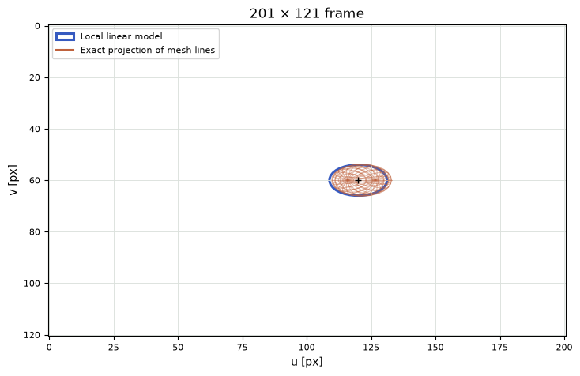
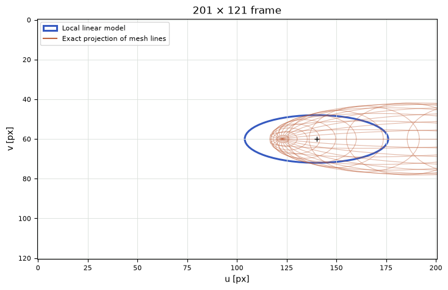

[Jupyter notebook](../../notebooks/en/lesson-13.ipynb)


# Lesson 13. How a volume leaves a footprint on the screen

[Course plan](../../README.md)

The center is easy. At a depth of 4 m, one meter to the right, an 80-pixel focal length puts it 20 pixels right of the middle. Yet there are other parts of the same cloud on both sides of that center. The nearer part appears larger than the farther one. What width should the entire spot have?

```python
%matplotlib inline
from pathlib import Path
import sys

course = next(p for p in (Path.cwd(), *Path.cwd().parents) if (p / "geometry3d.py").is_file())
if str(course) not in sys.path:
    sys.path.insert(0, str(course))

import numpy as np
import matplotlib.pyplot as plt
from IPython.display import display
import geometry3d as geo
import geometry_demos as demos
np.set_printoptions(precision=4, suppress=True)
```

## 1. Two drawings on the same sensor

Orange is the one-scale shell from the last lesson. Each mesh vertex gets a pixel location by dividing by its own depth. The blue ellipse takes a shortcut. We measure how the camera stretches tiny displacements only at the center and apply that stretch to the entire shape. The dark dot is the projected center in both calculations.

With a distant center and a thin shell in depth, the two outlines nearly agree. Bringing the cloud closer or stretching it along $z$ makes the near side of the orange mesh run away. The view angle moves the camera around a fixed shape while keeping the center at $(1,0,z)$ in camera coordinates. The long axis turns relative to the view. During that turn the dark dot stays put.

```python
display(demos.geometry_lab(13, "en"))
```

## 2. How many pixels come from a centimeter?

Horizontally the formula is familiar: $u=100+80x/z$. At center $(1,0,4)$ it gives $u=120$ px. Moving the point 0.01 m right without changing depth gives $100+80\cdot1.01/4=120.2$. The screen shift is 0.2 px, or $0.2/0.01=20$ pixels per meter. A vertical displacement in $y$ leaves the horizontal address alone.

Now let that centimeter go forward along $z$. The result is $100+80/4.01\approx119.950125$ px. A difference of $-0.049875$ px over 0.01 m gives about $-4.9875$ px/m. The minus sign is visible: the farther point moves toward the image center. What happens right at the center as the centimeter shrinks? With step $h$ and focal length $f_x$, subtracting removes the principal point:

```math
\begin{aligned}
\frac{u(z+h)-u(z)}{h}
&=\frac{f_x x}{h}\left(\frac{1}{z+h}-\frac{1}{z}\right)\\
&=\frac{f_x x}{h}\frac{z-(z+h)}{z(z+h)}
=-\frac{f_x x}{z(z+h)}.
\end{aligned}
```

A common denominator puts $-h$ in the numerator and cancels the nonzero step. As $h$ shrinks, the product in the denominator approaches $z^2$. The local response is $-f_x x/z^2=-80\cdot1/16=-5$ px/m. It is negative for positive $x$, and zero for a point exactly on the axis with $x=0$.

```python
mu = np.array([1., 0., 4.])
focal, principal = 80., (100., 60.)
uv = geo.project_point(mu, focal, principal)
for h in [.1, .01, .001]:
    moved = geo.project_point(mu+[0,0,h], focal, principal)
    print(f"h={h:g} m; Δu/h = {(moved[0]-uv[0])/h:.6f} px/m")
```

```text
h=0.1 m; Δu/h = -4.878049 px/m
h=0.01 m; Δu/h = -4.987531 px/m
h=0.001 m; Δu/h = -4.998750 px/m
```

```python
fig = demos.footprint_figure("en")
plt.show()
```



## 3. Six responses in one table

An image position has two numbers, $u$ and $v$. A spatial displacement has three, $\Delta x,\Delta y,\Delta z$. Each pair of response and cause has a local coefficient. The rows of table $J$ correspond to screen coordinates, the columns to spatial coordinates. This table of partial derivatives is the **Jacobian**. “Partial” means that each column moves just one coordinate at a time.

```math
J=
\begin{bmatrix}
f_x/z & 0 & -f_x x/z^2\\
0 & f_y/z & -f_y y/z^2
\end{bmatrix}
=\begin{bmatrix}20&0&-5\\0&20&0\end{bmatrix}.
```

Here $y=0$, so moving straight ahead does not change $v$. For a displacement $(0.1,0.05,0.2)$ m, multiplying the first row by the column gives $20\cdot0.1+0\cdot0.05-5\cdot0.2=1$ px. The second row gives $20\cdot0.05=1$ px. Adding the center $(120,60)$ predicts $(121,61)$ px. Exact division for the new point $(1.1,0.05,4.2)$ gives $(120.9524,60.9524)$ px. A smaller displacement leaves a smaller discrepancy.

For a whole meter farther in depth the Jacobian predicts $120-5=115$ px. Exact projection at a depth of 5 m gives $100+80/5=116$ px. A meter **toward** the camera gives a prediction of $120+5=125$ px but an exact result of $100+80/3\approx126.667$ px. A straight line has the same slope on both sides, whereas the slope of perspective division changes along the way.

```python
J = geo.projection_jacobian(mu, focal)
for delta in [[.1,.05,.2],[0,0,1],[0,0,-1]]:
    linear = uv + J @ delta
    exact = geo.project_point(mu+delta, focal, principal)
    print("Δ =", delta, "  linear =", linear, "  exact =", exact)
```

```text
Δ = [0.1, 0.05, 0.2]   linear = [121.  61.]   exact = [120.9524  60.9524]
Δ = [0, 0, 1]   linear = [115.  60.]   exact = [116.  60.]
Δ = [0, 0, -1]   linear = [125.  60.]   exact = [126.6667  60.    ]
```

## 4. Turning a volume into an ellipse with six numbers

In the initial view the cloud's camera-space covariance is $\Sigma_c=\mathrm{diag}(0.25,0.09,1)$ m². Those values are the squares of the scales $0.5$, $0.3$, $1$ m. On the screen the displacements follow coefficients $J$. The two screen directions transform both sides of the covariance:

```math
\Sigma_2=J\Sigma_c J^{\mathsf T}.
```

This is the earlier multiplication on both sides, now connecting three input axes to two output axes. We can assemble it by hand. Along $u$, a local $x$ displacement of 0.5 m contributes a scale of $20\cdot0.5=10$ px. One meter along $z$ contributes $-5\cdot1=-5$ px. Independent directions add their **squared** contributions: $10^2+(-5)^2=125$ px². Taking the square root returns a length, $\sqrt{125}\approx11.180$ px. Along $v$ only $y$ contributes: $20\cdot0.3=6$ px, whose square is 36 px².

For a cross term to appear, the same local axis must contribute to both $u$ and $v$. Here $u$ uses $x,z$ while $v$ uses only $y$. Hence the cross term vanishes and the result is $\mathrm{diag}(125,36)$. At zero view angle, changing “Shape rotation” to $45^\circ$ turns the long and short transverse axes together. Their cross covariance is now $(0.25-0.09)/2=0.08$ m². Each screen direction magnifies displacements by a factor of 20. Thus $\Sigma_{uv}=20\cdot0.08\cdot20=32$ px². The blue ellipse leans down to the right. The resulting $2\times2$ matrix and center describe the familiar spot from lesson 4.

What if the original shape is given in the world? Camera orientation $B$ from lesson 10 takes camera axes into the world. The reverse direction, **world to camera**, takes displacements through $W=B^{\mathsf T}$. First comes $\Sigma_c=W\Sigma_w W^{\mathsf T}$, then $J$. Camera translation cancels for differences between nearby points, but stays in the position of the center where $J$ is evaluated. [Kerbl and colleagues' paper](https://repo-sam.inria.fr/fungraph/3d-gaussian-splatting/) combines these two steps. Keeping them separate here makes it easier to track each matrix's units.

```python
cov3 = geo.covariance_3d([.5,.3,1], [1,0,0,0])
cov2 = geo.projected_covariance(mu, cov3, focal)
print("J =\n", J, "\nΣ₂ =\n", cov2, "\nradii =", np.sqrt(np.diag(cov2)), "px")
np.testing.assert_allclose(cov2, np.diag([125,36]))
tilted = geo.covariance_3d([.5,.3,1], geo.axis_angle_quaternion([0,0,1],45))
np.testing.assert_allclose(geo.projected_covariance(mu, tilted, focal), [[93,32],[32,68]])
```

```text
J =
 [[20.  0. -5.]
 [ 0. 20. -0.]]
Σ₂ =
 [[125.   0.]
 [  0.  36.]]
radii = [11.1803  6.    ] px
```

## 5. Where the blue curve falls behind

The near plane in the experiment lies at 0.2 m. Suppose the center has $z=2$ and the depth scale is 1.5 m. The shell's nearest tip lies at $2-1.5=0.5$ m. Even that tip is still in front of the camera, but dividing by 0.5 or by 2 now gives very different answers. Only the part of the orange mesh that falls inside the frame appears in the drawing.

Lowering center depth to 1 m at the same scale brings part of the shell across the near plane. Those points are excluded from the orange mesh. The center still has a Jacobian and we can draw the blue ellipse. Having enough numbers to draw it is easier than getting an accurate outline. The Gaussian itself also has infinite tails. This experiment compares the chosen $D^2=1$ shell, as distinct from a light integral along a ray or the exact projection of the entire density.

**An experiment.** The center moves onto the optical axis at $(0,0,4)$. Does doubling only $s_z$ change the blue ellipse if the principal axes line up with the camera?

<details>
<summary>Working it out</summary>

Both depth coefficients vanish: $-80\cdot0/16=0$. Inside the linear model the $s_z$ contribution disappears. The radii are $20\cdot0.5=10$ and $20\cdot0.3=6$ px. The orange mesh still changes as it thickens, because its off-center points each have their own $x,y,z$.

</details>

**Estimating error.** How far off is the horizontal prediction for a point 0.5 m nearer than the original center $(1,0,4)$?

<details>
<summary>Working it out</summary>

The step is $\Delta z=-0.5$. The Jacobian predicts $120+(-5)(-0.5)=122.5$ px. Exact division gives $100+80/3.5\approx122.857$ px. The difference is about 0.357 px. The next scene will contain several such footprints and introduce the question of which one contributes to a pixel first.

</details>

```python
fig = demos.footprint_figure("en", depth=2, sz=1.5)
plt.show()
```


