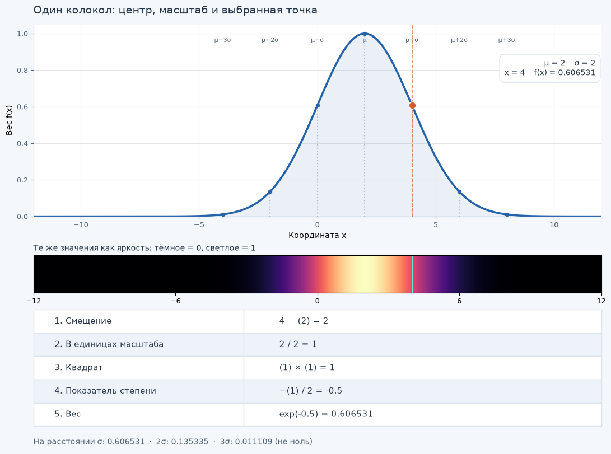
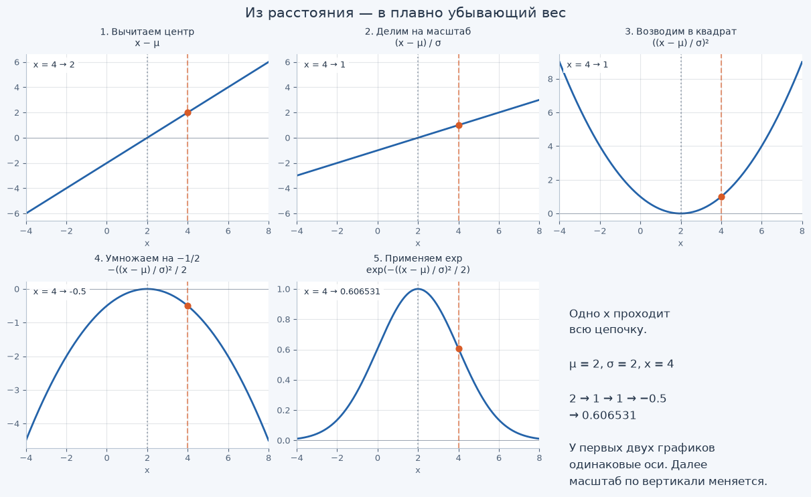
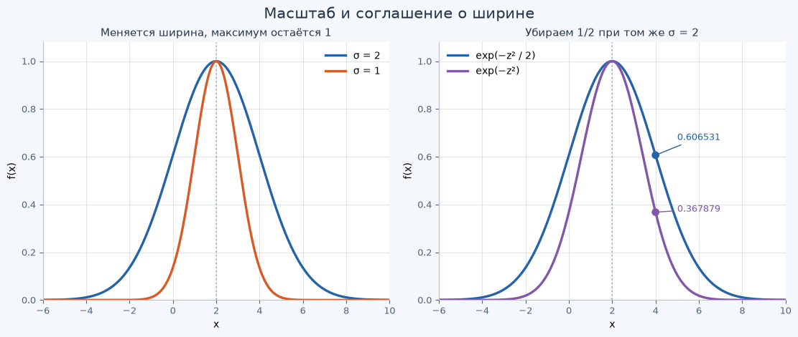

[Jupyter-ноутбук](../../notebooks/ru/lesson-02.ipynb)


# Урок 2 — Одна гауссиана на прямой: разбираем колокол

[Программа курса](../../README_ru.md) · [Предыдущий урок](lesson-01.md) · [English version](../en/lesson-02-en.md) · [Дальше: гауссиана на плоскости](lesson-03.md)

Возьмём один колокол и попробуем с ним разобраться. Сначала подвигаем его и поменяем ширину. Затем выберем точку на графике и вручную посчитаем, почему она оказалась именно на такой высоте. По пути разберём каждую операцию в формуле.

Для начала хватит обычной арифметики и умения запустить ячейку Python. До производных, матриц и теории вероятностей ещё доберёмся. Пока работаем с **одномерной** гауссианой: даём ей одну координату и получаем одно число.

В первом уроке мы собирали изображение из мягких пятен. Теперь проведём через одно пятно линию и посмотрим, как меняется его влияние вдоль неё: в середине сильнее, дальше слабее. Это влияние будем описывать числом — весом. А цвет пикселя и перекрытия нескольких пятен оставим на следующие уроки.

## 1. Колокол и три параметра

У графика есть центр, ширина и точка, в которой измеряется вес. Сначала посмотрим, как они связаны с картинкой. Саму гауссиану затем посчитаем по шагам, обычной арифметикой.

```python
%matplotlib inline
from pathlib import Path
import sys

LANG = "ru"

course_root = next(
    (path for path in (Path.cwd(), *Path.cwd().parents)
     if (path / "course_demos.py").is_file()),
    None,
)
if course_root is None:
    raise FileNotFoundError("Open this notebook from the course repository.")
if str(course_root) not in sys.path:
    sys.path.insert(0, str(course_root))

from IPython.display import display
from course_demos import (
    gaussian_lab,
    gaussian_figure,
    construction_figure,
    width_figure,
)
```

```python
display(gaussian_figure(mu=2, sigma=2, x=4, language=LANG))
display(gaussian_lab(language=LANG))
```



Пока оставим формулу в стороне. На графике видны три разных изменения:

1. Центр переходит с 2 на −2. Колокол переезжает, но его форма и высота сохраняются.
2. Центр снова в 2, а ширина уменьшается с 2 до 1. Колокол становится уже, вершина остаётся на высоте 1.
3. Ширина снова равна 2, точка измерения движется вдоль графика. В каждом месте получается свой вес, а сам колокол остаётся прежним.

Оси закреплены, поэтому перемещение колокола видно относительно одной и той же шкалы. Для следующих расчётов возьмём **центр 2 и ширину 2**, а вес начнём считать в точке **4**.

## 2. Как прочитать одну точку графика

Возьмём обычную линейку. Мы выбрали отметку 4 и хотим узнать вес в этом месте.

| Запись | Как читать | Что это у нас |
|---|---|---|
| $x$ | «икс» | Координата, которую проверяем: 4 |
| $\mu$ | «мю» | Центр колокола: 2 |
| $\sigma$ | «сигма» | Масштаб ширины: 2; обязательно больше нуля |
| $f(x)$ | «эф от икс» | Вес, который получим в точке $x$ |

Скобки в $f(x)$ обозначают вход функции. Это **не** умножение буквы $f$ на число $x$. Слово «функция» здесь означает правило: получил координату — выполнил действия — вернул число.

У нашего колокола $f(2)=1$: в центре вес максимален. Запись $f(4)$ означает «вычисли вес в точке 4». Дальше получим приблизительно 0.606531.

Меняя $\mu$ и $\sigma$, мы меняем сам колокол. А меняя $x$, только выбираем, в каком его месте посмотреть вес.

## 3. Шаг первый: отсчитываем от центра

Координата сама по себе не говорит, далеко ли мы от колокола. Точка 100 может быть прямо в центре, если центр тоже 100.

Поэтому сначала вычитаем центр:

```math
d=x-\mu.
```

Полученное **смещение от центра** назовём $d$, чтобы не переписывать вычитание каждый раз. При $x=4$ и $\mu=2$:

```math
d=4-2=2.
```

Мы на две единицы правее центра. Теперь возьмём $x=0$:

```math
d=0-2=-2.
```

Теперь мы на две единицы левее центра. Минус говорит, с какой стороны находится точка, а число 2 — как далеко она от центра. В самом центре получаем $d=2-2=0$.

От точек на одинаковом расстоянии слева и справа мы ждём одинакового веса. Пока у нас получились разные числа: $2$ и $-2$. Чуть дальше, на шаге с квадратом, они станут одинаковыми.

## 4. Шаг второй: измеряем смещение в единицах ширины

До центра две единицы. Для узкого пятна это может быть далеко, а для широкого — совсем рядом. Одного расстояния мало: нужно ещё сравнить его с шириной пятна.

```math
u=\frac{d}{\sigma}.
```

Дробная черта означает деление. Результат назовём $u$: теперь мы измеряем **смещение в единицах ширины**. Подставим наши числа:

```math
u=\frac{2}{2}=1.
```

То есть точка находится на одну ширину правее центра. Слева получаем $(-2)/2=-1$.

Если оставить точку и центр прежними, но сделать $\sigma=1$, то $u=2/1=2$: та же точка теперь находится на две ширины от центра. Если сделать $\sigma=4$, то $u=2/4=0.5$: всего на половину ширины.

Значения $x,\mu,\sigma$ записываем в одинаковых единицах. Если координаты в сантиметрах, ширина тоже должна быть в сантиметрах. При делении «2 см / 2 см» сантиметры сокращаются, остаётся просто 1. Такое число называют **безразмерным**. Мы узнали, сколько ширин отделяет точку от центра; выбор сантиметров или метров на этот ответ не влияет.

$\sigma$ задаёт масштаб ширины. Полную ширину пятна она не измеряет и границу не отмечает: у нашего колокола вообще нет резкого края.

## 5. Шаг третий: делаем левую и правую стороны одинаковыми

Возведём относительное смещение в квадрат:

```math
q=u^2=u\cdot u.
```

Маленькая двойка сверху означает «умножь число само на себя». Точка посередине — знак умножения.

Справа от центра:

```math
q=1^2=1\cdot1=1.
```

Слева от центра:

```math
q=(-1)^2=(-1)\cdot(-1)=1.
```

Произведение двух отрицательных чисел положительно. Поэтому обе стороны дают один результат. В центре $q=0^2=0$. На расстоянии двух ширин $q=2^2=4$, трёх ширин — $q=3^2=9$.

После возведения в квадрат левая и правая стороны совпали, а числа по мере удаления от центра растут всё быстрее. Пока получается обратное тому, что нам нужно: в центре ноль, дальше больше. У **веса** должно быть наоборот — больше всего в центре, а дальше всё меньше.

Квадрат здесь выбран потому, что мы строим именно гауссиану. Можно взять модуль — величину без знака — и тоже получить симметричное пятно, но его профиль будет другим. Мягких пятен бывает много; сейчас разбираемся, как получается одно из них.

## 6. Шаг четвёртый: делим на два и ставим минус

Теперь делим квадрат на 2 и меняем знак:

```math
t=-\frac{q}{2}.
```

Результат этого шага назовём $t$. Здесь буква не связана со временем — просто ещё одно короткое имя. Сначала делим, затем ставим минус:

- в центре: $q=0$, поэтому $t=-0/2=0$;
- на одной ширине: $q=1$, поэтому $t=-1/2=-0.5$;
- на двух ширинах: $q=4$, поэтому $t=-4/2=-2$;
- на трёх ширинах: $q=9$, поэтому $t=-9/2=-4.5$.

Чем дальше от центра, тем глубже число уходит в минус. Остался один шаг: превратить эти числа в **положительные** веса, которые будут уменьшаться.

Двойка в делителе влияет на то, как быстро будет уменьшаться вес. Она входит в обычную запись гауссианы и задаёт связь между её шириной и параметром масштаба. Если убрать двойку и оставить то же $\sigma$, колокол станет уже. Ниже сравним обе картинки и посчитаем разницу. Сам по себе колокол можно построить и без этой двойки.

## 7. Последний шаг: что такое exp и число e

Мы дошли до $t=-0.5$, но это ещё не вес. Нам нужна операция, у которой:

- вход 0 даёт выход 1;
- отрицательный вход даёт положительное число меньше 1;
- более отрицательный вход даёт меньший выход.

Так работает экспонента:

```math
\exp(t)=e^t.
```

Слева «exp» — имя функции, $t$ в скобках — её вход. Справа та же операция записана как степень. $e$ — постоянное число, приблизительно **2.71828**; $t$ — показатель степени. «Приблизительно» означает, что здесь показаны только первые цифры.

Со степенью −0.5 сходу не очень понятно, что делать. Начнём с привычного числа 2 и дойдём до этой записи по шагам.

### Положительная, нулевая и отрицательная степень

С положительными целыми степенями всё сводится к умножению:

```math
2^1=2,\qquad 2^2=2\cdot2=4,\qquad 2^3=2\cdot2\cdot2=8.
```

Переход от степени 3 к степени 2 — деление на 2: $8/2=4$. Ещё шаг вниз: $4/2=2$. Продолжим то же правило:

| Показатель | Действие | Значение |
|---|---|---:|
| 1 | Начальное число | 2 |
| 0 | $2/2$ | 1 |
| −1 | $1/2$ | 0.5 |
| −2 | $0.5/2$ | 0.25 |

Поэтому $2^0=1$, а $2^{-2}=1/(2\cdot2)=1/4$.

То же правило работает для любого положительного основания, в том числе для $e$:

```math
e^0=1,\qquad e^{-1}=\frac{1}{e},\qquad e^{-2}=\frac{1}{e^2}.
```

**Минус в показателе не делает ответ отрицательным.** Он означает, что единицу делим на результат возведения в положительную степень. Это и называется обратным числом.

### Половинная степень

Что означает степень 0.5? Это половина единицы: $0.5=1/2$. Для положительного числа степень $1/2$ означает **квадратный корень**.

Корень из числа — такое неотрицательное число, которое при умножении само на себя даёт исходное. Например, $\sqrt{9}=3$, потому что $3\cdot3=9$. Знак **√** читается «квадратный корень».

Две одинаковые половины показателя вместе дают показатель 1. Поэтому $e^{1/2}\cdot e^{1/2}=e^1=e$, то есть $e^{1/2}=\sqrt{e}$. Теперь применим правило отрицательной степени:

```math
e^{-0.5}=\frac{1}{e^{0.5}}=\frac{1}{\sqrt{e}}.
```

Посчитаем приблизительно:

```math
e\approx2.71828,\qquad
\sqrt{e}\approx1.64872,\qquad
\frac{1}{1.64872}\approx0.60653.
```

Знак $\approx$ читается «приблизительно равно». В итоговом расчёте Python использует более точное значение $e$, поэтому мы округляем только для показа.

С другими дробными показателями работает та же идея. Например, возведение в степень $1/4$ даёт число, которое нужно перемножить само с собой четыре раза, чтобы получить основание. Если разрешить любой вещественный показатель, эти значения продолжатся в непрерывную кривую. Вручную считать каждую такую степень не придётся: в коде этим займётся `math.exp`.

### Откуда взялось именно число e

До сих пор мы просто пользовались готовым числом $e$. Попробуем получить приближение к нему сами — через несколько умножений.

Начнём с 1. Одно увеличение на 100% даёт $1\cdot(1+1)=2$. А теперь то же увеличение разобьём на два последовательных шага по 50% **от текущего значения**:

```math
1\cdot(1+1/2)\cdot(1+1/2)=1\cdot1.5\cdot1.5=2.25.
```

Результат больше 2, потому что второй раз увеличиваем уже 1.5, а не начальную единицу.

Если разделить процесс на $n$ одинаковых шагов, каждый умножает текущий результат на $1+1/n$. Буква $n$ — число шагов; это положительное целое число. После $n$ умножений получаем:

```math
a_n=\left(1+\frac{1}{n}\right)^n.
```

Результат назвали $a_n$. Маленький индекс снизу напоминает, какое $n$ мы выбрали. Читаем действия по порядку: делим 1 на $n$, прибавляем 1 и умножаем полученное число само на себя $n$ раз.

Будем увеличивать $n$ — результаты начнут всё ближе подходить к одному числу. Это и есть $e$. Его называют пределом этой последовательности: тем значением, к которому она приближается, если увеличивать число шагов без конца. При любом конечном $n$ у нас будет только приближение.

Проверим это в следующей ячейке. В Python `**` означает возведение в степень. Запись `.8f` просит показать восемь цифр после десятичной точки; сам расчёт от этого не меняется.

```python
import math

for n in [1, 2, 10, 100, 1000, 10000]:
    approximation = (1 + 1 / n) ** n
    print(f"n = {n:5d} -> {approximation:.8f}")

print(f"math.e     -> {math.e:.8f}")
```

```text
n =     1 -> 2.00000000
n =     2 -> 2.25000000
n =    10 -> 2.59374246
n =   100 -> 2.70481383
n =  1000 -> 2.71692393
n = 10000 -> 2.71814593
math.e     -> 2.71828183
```

Теперь понятно, откуда берётся само число $e$, и для этого нам пока хватило арифметики. Экспонента с таким основанием входит в привычную запись гауссианы. Но по одному виду мягкого пятна нельзя вывести ни $e$, ни квадрат, ни коэффициент $1/2$. Мы выбрали конкретную модель пятна и разбираем, как она устроена.

Проверим нужные нам значения. В записи `math.exp(t)` модуль `math` содержит математические функции, а `exp` вычисляет $e^t$. В цикле `t` по очереди получает четыре указанных значения.

```python
for t in [0, -0.5, -2, -4.5]:
    weight = math.exp(t)
    print(f"exp({t:4.1f}) = {weight:.6f}")
```

```text
exp( 0.0) = 1.000000
exp(-0.5) = 0.606531
exp(-2.0) = 0.135335
exp(-4.5) = 0.011109
```

Число $-4.5$ гораздо меньше нуля, но $\exp(-4.5)$ всё ещё **положительно** — примерно 0.011109. Это 1.1109% от вершины, потому что $0.011109\cdot100=1.1109$.

Процент — доля от ста. Здесь за 100% мы взяли вес в вершине, равный 1, и сравниваем с ним остальные веса. Вероятность попасть в точку или долю площади под кривой этим числом мы не измеряем.

## 8. Собираем все действия в одну формулу

Наш рецепт:

```math
d=x-\mu,\qquad
u=\frac{d}{\sigma},\qquad
q=u^2,\qquad
t=-\frac{q}{2},\qquad
f(x)=\exp(t).
```

На каждом шаге мы берём результат предыдущего. Теперь подставим вместо коротких имён сами действия — так вся цепочка соберётся в одну строку:

```math
f(x)=\exp\left(-\frac{1}{2}
\left(\frac{x-\mu}{\sigma}\right)^2\right).
```

Здесь умножение на $1/2$ — то же самое, что деление на 2. Квадрат дроби можно развернуть:

```math
\begin{aligned}
\left(\frac{x-\mu}{\sigma}\right)^2
&=\frac{x-\mu}{\sigma}\cdot\frac{x-\mu}{\sigma}\\
&=\frac{(x-\mu)(x-\mu)}{\sigma\cdot\sigma}\\
&=\frac{(x-\mu)^2}{\sigma^2}.
\end{aligned}
```

Числители перемножили между собой, знаменатели тоже. Теперь можно записать формулу короче:

```math
\boxed{f(x)=\exp\left(-\frac{(x-\mu)^2}{2\sigma^2}\right)}.
```

Теперь видно, откуда взялся квадрат ширины внизу: мы возвели в квадрат **всю дробь со смещением**. Скобки вокруг $x-\mu$ задают порядок: сначала вычитаем центр и только потом возводим полученное число в квадрат.

Ниже те же действия показаны на графиках. На каждом шаге меняется вся линия, а отмеченная точка проходит через уже знакомые нам числа.

```python
display(construction_figure(language=LANG))
```



## 9. Полный расчёт: точка 4, центр 2, ширина 2

Соберём расчёт для нашей точки в одну таблицу. Все действия уже знакомы:

| Шаг | Вычисление | Смысл |
|---|---|---|
| Смещение | $4-2=2$ | Две единицы правее центра |
| Деление на ширину | $2/2=1$ | Одна ширина от центра |
| Квадрат | $1\cdot1=1$ | Одинаковый результат для обеих сторон |
| Деление на 2 и минус | $-1/2=-0.5$ | Показатель для убывающего веса |
| Экспонента | $e^{-0.5}\approx0.606531$ | Вес в выбранной точке |

Итак, **$f(4)\approx0.606531$**. На графике это высота точки над отметкой 4. На светлой полосе — соответствующая ей яркость.

Теперь тот же расчёт в Python. Имена переменных повторяют этапы: `offset` — смещение, `relative` — относительное смещение, `squared` — его квадрат, `exponent` — показатель степени, `weight` — итоговый вес. Знак `=` в коде сохраняет результат справа в переменную слева.

```python
x = 4.0
mu = 2.0
sigma = 2.0

offset = x - mu
relative = offset / sigma
squared = relative * relative
exponent = -squared / 2
weight = math.exp(exponent)

print(f"x - mu                 = {offset:.6f}")
print(f"(x - mu) / sigma       = {relative:.6f}")
print(f"relative * relative    = {squared:.6f}")
print(f"-squared / 2           = {exponent:.6f}")
print(f"exp(exponent)          = {weight:.6f}")
```

```text
x - mu                 = 2.000000
(x - mu) / sigma       = 1.000000
relative * relative    = 1.000000
-squared / 2           = -0.500000
exp(exponent)          = 0.606531
```

### Проверяем другую сторону и вершину

Для $x=0$, $\mu=2$, $\sigma=2$:

```math
d=0-2=-2,\qquad
u=-2/2=-1,\qquad
q=(-1)\cdot(-1)=1,
```

```math
t=-1/2=-0.5,\qquad
f(0)=e^{-0.5}\approx0.606531.
```

Получили тот же вес, что и справа. На картинке колокол выглядел симметричным; теперь это совпадение видно и в расчёте.

Для $x=2$, то есть прямо в центре:

```math
d=2-2=0,\qquad
u=0/2=0,\qquad
q=0\cdot0=0,
```

```math
t=-0/2=0,\qquad
f(2)=e^0=1.
```

Если ширина положительна, в центре всегда повторяется эта цепочка: нулевое смещение → нулевой показатель → вес 1.

Для $x=6$: $d=6-2=4$, $u=4/2=2$, $q=2\cdot2=4$, $t=-4/2=-2$, поэтому $f(6)=e^{-2}\approx0.135335$.

Для $x=8$: $d=8-2=6$, $u=6/2=3$, $q=3\cdot3=9$, $t=-9/2=-4.5$, поэтому $f(8)=e^{-4.5}\approx0.011109$.

Теперь пусть Python пройдёт эти шаги для всех пяти точек. Цикл повторит знакомый расчёт несколько раз и соберёт результаты в таблицу.

```python
mu = 2.0
sigma = 2.0

print(" x    offset  relative  squared  exponent    weight")
for x in [2.0, 4.0, 0.0, 6.0, 8.0]:
    offset = x - mu
    relative = offset / sigma
    squared = relative * relative
    exponent = -squared / 2
    weight = math.exp(exponent)
    print(
        f"{x:3.0f}  {offset:8.1f}  {relative:8.1f}  "
        f"{squared:7.1f}  {exponent:8.1f}  {weight:10.6f}"
    )
```

```text
x    offset  relative  squared  exponent    weight
  2       0.0       0.0      0.0      -0.0    1.000000
  4       2.0       1.0      1.0      -0.5    0.606531
  0      -2.0      -1.0      1.0      -0.5    0.606531
  6       4.0       2.0      4.0      -2.0    0.135335
  8       6.0       3.0      9.0      -4.5    0.011109
```

## 10. Что именно меняет ширина и зачем в формуле двойка

Оставим $x=4$ и $\mu=2$ на своих местах, а ширину уменьшим с 2 до 1:

```math
d=4-2=2,\quad
u=2/1=2,\quad
q=2\cdot2=4,\quad
t=-4/2=-2,
```

```math
f(4)=e^{-2}\approx0.135335.
```

Было 0.606531, стало 0.135335. Мы не двигали точку, но после сужения она оказалась дальше от центра **в единицах ширины**. Поэтому вес уменьшился. В центре по-прежнему 1.

Теперь вернём $\sigma=2$, но временно удалим делитель 2 из показателя. При $x=4$ относительное смещение равно 1:

- с делителем: показатель $-1/2=-0.5$, вес около 0.606531;
- без делителя: показатель $-1=-1$, вес около 0.367879.

Убрали делитель — вес стал уменьшаться быстрее. По сути, мы сузили колокол, хотя число в настройке ширины оставили прежним.

Точно такой же узкий колокол можно получить и обычной формулой, если подобрать другую ширину. Посчитаем какую. При старой ширине 2 и без делителя знаменатель равен $2^2=4$. Теперь ищем положительную ширину $w$, которая даст тот же знаменатель в обычной формуле:

```math
2w^2=4.
```

Здесь $w$ — только имя новой ширины. Делим обе стороны на 2: $w^2=2$. Значит $w=\sqrt{2}\approx1.414214$. Это меньше 2.

Получается, коэффициент $1/2$ — **часть соглашения о том, как измерять ширину**. Колокол получится и без него, но численная настройка будет другой. В статистике при таком соглашении $\sigma$ совпадает со стандартным отклонением соответствующей нормированной гауссианы. Считать стандартное отклонение по набору данных сейчас не нужно: здесь мы сами выбираем $\sigma$ ползунком или в коде.

Слева на рисунке меняем ширину в одной и той же формуле. Справа оставляем ширину прежней и смотрим, что произошло после удаления двойки.

```python
display(width_figure(language=LANG))
```



## 11. Что означает посчитанный вес

У нашей гауссианы вершина всегда равна 1. Её называют **ненормированной**: мы не добавляли множитель, который сделал бы площадь под графиком равной единице. Разберёмся, зачем вообще об этом говорить.

Закрасим область под графиком. Растянем колокол по горизонтали, сохранив высоту, — закрашенная площадь вырастет. Для нашего веса это нормально. Если бы мы строили плотность вероятности, площадь пришлось бы сохранять равной единице; здесь такой задачи пока нет.

Наши 0.606531 говорят о силе влияния в этой точке относительно центра. Прочитать это как «вероятность 60.6531% оказаться именно здесь» нельзя. Непрозрачность всей гауссианы и окончательный цвет пикселя мы тоже ещё не посчитали.

Позже к этому весу добавим цвет, параметр непрозрачности и смешивание с соседними гауссианами. Сейчас нам было нужно разобраться с одной частью: **как влияние плавно уменьшается при удалении от центра**.

Пятно от фонарика помогает это представить. Только у настоящего фонарика профиль может быть другим: точную форму нашего пятна задаёт формула, которую мы только что разобрали.

## 12. Нулевая ширина, отрицательные координаты и хвосты колокола

**Ширину берём больше нуля.** При $\sigma=0$ нужно было бы делить на ноль. Формула в таком виде не определена даже в центре: там возникло бы $0/0$. Подставить −2 вместо ширины тоже не будем. После возведения в квадрат профиль вышел бы таким же, как при 2, но отрицательная длина нам здесь ни к чему. Договоримся использовать только $\sigma>0$.

**А координаты могут быть отрицательными.** Если $x$ или центр $\mu$ меньше нуля, мы просто выбрали отметку слева от нуля на линейке. Со знаком ширины это ограничение не связано.

**Вес не превышает 1.** Квадрат неотрицателен, после деления и минуса показатель не больше нуля. У положительной экспоненты нулевой показатель даёт 1, а отрицательный — меньше 1.

**На трёх ширинах колокол ещё не заканчивается.** При удалённости $3\sigma$ вес равен $e^{-4.5}\approx0.011109$, а при $4\sigma$: относительное смещение 4 → квадрат 16 → показатель $-16/2=-8$ → вес $e^{-8}\approx0.000335$.

В точной математике для любой конечной координаты и положительной конечной ширины вес больше нуля. На компьютере очень маленькое значение иногда округляется до нуля из-за ограниченной точности хранения. Это ограничение вычислений, а не обрыв математической кривой.

В рендерере слабые хвосты иногда отбрасывают, чтобы быстрее получить изображение. Однако расстояние $3\sigma$ само по себе ещё не говорит, что вкладом можно пренебречь. Нужно учитывать непрозрачность, соседние элементы и то, насколько точная картинка нам нужна.

## 13. Функция для экспериментов

Осталось собрать наши действия в функцию. Передадим ей `x`, `mu`, `sigma` и получим вес. Строка с `sigma <= 0` проверит ширину: если она нулевая или отрицательная, функция остановится и покажет ошибку.

В опытах все числа конечные — без бесконечности и специальных значений вроде `NaN`. Каждое из пяти действий оставлено отдельной строкой: можно идти по коду сверху вниз и сверяться с расчётом.

```python
def gaussian_weight(x, mu, sigma):
    if sigma <= 0:
        raise ValueError("sigma must be greater than zero")

    offset = x - mu
    relative = offset / sigma
    squared = relative * relative
    exponent = -squared / 2
    return math.exp(exponent)


x = 4.0
mu = 2.0
sigma = 2.0

print(f"weight = {gaussian_weight(x, mu, sigma):.6g}")
```

```text
weight = 0.606531
```

Для следующих опытов есть два результата: ожидаемое изменение графика и число, которое вернёт код. Сравним их для каждого случая:

| Меняем одно значение, остальные оставляем исходными | Что проверить |
|---|---|
| `x = 0.0` | Равен ли вес значению в точке 4? Почему? |
| `mu = 4.0` | Какой вес будет в выбранной точке 4? |
| `sigma = 1.0` | Станет ли вес в точке 4 больше или меньше? |
| `sigma = 4.0` | Насколько теперь удалена точка в единицах ширины? |
| `sigma = 0.0` | Почему функция должна остановиться, а не выдать картинку? |

В каждом опыте меняется один параметр; остальные остаются исходными. Значения в пределах ползунков дают ещё и наглядную проверку на первом графике. Ползунки до μ = 4 и σ = 4 не доходят, хотя формула с такими числами работает. Эти случаи показывает вызов `gaussian_figure` с аргументами `mu=4, sigma=2, x=4` или `mu=2, sigma=4, x=4` вместо исходных.

Для нулевой ширины вызываем только `gaussian_weight`. Возникает ошибка `ValueError`: срабатывает защита от деления на ноль. Графика для этого случая нет. Возвращение `sigma=2` восстанавливает обычный расчёт без ошибки.

<details>
<summary>Ответы к экспериментам с параметрами</summary>

**Точка слева, $x=0$.** Смещение $0-2=-2$, относительное смещение $-2/2=-1$, квадрат $(-1)^2=1$, показатель $-1/2=-0.5$. Вес $e^{-0.5}\approx0.606531$. Это тот же результат, что у $x=4$, благодаря квадрату.

**Центр в точке измерения, $\mu=4$.** Смещение $4-4=0$, деление $0/2=0$, квадрат 0, показатель 0. Вес $e^0=1$. Мы передвинули весь колокол так, что выбранная точка стала вершиной.

**Ширина $\sigma=1$.** Смещение $4-2=2$, относительное смещение $2/1=2$, квадрат 4, показатель −2. Вес $e^{-2}\approx0.135335$. Колокол сузился, вес этой точки уменьшился.

**Ширина $\sigma=4$.** Смещение 2, относительное смещение $2/4=0.5$, квадрат $0.5\cdot0.5=0.25$, показатель $-0.25/2=-0.125$. Вес $e^{-0.125}\approx0.882497$. Точка всего на половину ширины от центра; её вес вырос.

**Ширина $\sigma=0$.** Уже действие $2/0$ не определено. Проверка останавливает функцию до деления. Это не значение веса 0, не бесконечный вес и не корректная гауссиана.

</details>

### Как читать очень маленькие числа

В лаборатории маленькое число может выглядеть так: `1.523e-8`. Здесь буква `e` — **обозначение формата записи числа в Python**, а не отдельный множитель $e\approx2.71828$.

Запись читается «1.523 умножить на десять в степени минус восемь»:

```math
1.523\mathrm{e}{-8}
=1.523\cdot10^{-8}
=\frac{1.523}{100\,000\,000}
=0.00000001523.
```

Мы уже умеем читать отрицательную степень: $10^{-8}$ — единица, делённая на восемь перемноженных десяток. Так маленький положительный результат помещается в короткую запись, и нам не приходится пересчитывать нули.

В таблицах выше `.6f` округляет печать до шести знаков после точки. Поэтому очень маленькое число в таком формате может выглядеть как `0.000000`, хотя внутри осталось положительным. В последней функции используется `.6g`: шесть значащих цифр с переходом к короткой записи при необходимости. Округление вывода отличается от настоящего округления значения до нуля внутри вычислений.

## 14. Ещё несколько изменений формулы

Каждое изменение можно проследить через пять действий: вычесть, разделить, возвести в квадрат, разделить на 2 и поменять знак, вычислить экспоненту.

### Задание 1. Одни координаты, разные единицы

В первом случае $x=4$ см, $\mu=2$ см, $\sigma=2$ см. Во втором те же величины записаны в метрах: $x=0.04$, $\mu=0.02$, $\sigma=0.02$. Изменится ли вес?

<details>
<summary>Разбор</summary>

В сантиметрах смещение $4-2=2$, относительное смещение $2/2=1$. Дальше квадрат 1, показатель −0.5, вес около 0.606531.

В метрах смещение $0.04-0.02=0.02$, относительное смещение $0.02/0.02=1$. Все следующие действия те же: квадрат 1, показатель −0.5, вес около 0.606531.

Физическое положение относительно ширины не изменилось. Изменился только способ записать длины. Важно перевести **все три** величины: смешивать сантиметры и метры в одном отношении нельзя.

</details>

### Задание 2. Что сломается без квадрата?

Пусть центр 2, ширина 2. Для точек 4 и 0 пропустим возведение относительного смещения в квадрат: сразу разделим его на 2, поставим минус и вычислим экспоненту. Сохранятся ли симметрия и вершина 1?

<details>
<summary>Разбор</summary>

Для точки 4: смещение $4-2=2$, относительное смещение $2/2=1$. Без квадрата показатель $-1/2=-0.5$, результат около 0.606531.

Для точки 0: смещение $0-2=-2$, относительное смещение $-2/2=-1$. Без квадрата показатель $-(-1)/2=+0.5$, результат $e^{0.5}=\sqrt{e}\approx1.648721$.

Одинаковые расстояния дали разные значения. Более того, слева вес стал больше 1 и превысил значение в центре. Симметричный колокол потерялся. Вот для чего нам понадобился квадрат.

</details>

### Задание 3. Что сломается без минуса?

Теперь квадрат остаётся, а минус перед делением исчезает. Что получится в центре и на одну ширину от него?

<details>
<summary>Разбор</summary>

В центре относительное смещение 0, квадрат 0, показатель $0/2=0$. Результат 1.

На одной ширине относительное смещение равно 1 или −1, квадрат в обоих случаях 1. Без минуса показатель $1/2=+0.5$, результат около 1.648721. На двух ширинах квадрат 4, показатель $4/2=2$, результат $e^2\approx7.389056$.

Влияние растёт при удалении. Симметрия осталась, но центр стал минимумом. Минус превращал увеличение квадрата удалённости в убывание веса.

</details>

### Задание 4. Если ширина удвоилась, вершина станет вдвое ниже?

И можно ли сказать, что за пределами трёх ширин гауссиана заканчивается?

<details>
<summary>Разбор</summary>

Нет. В центре $x=\mu$, поэтому смещение 0. При любой положительной ширине $0/\sigma=0$, квадрат 0, показатель 0, итог $e^0=1$. Увеличение ширины растягивает профиль, а не меняет нашу заданную высоту вершины.

На расстоянии трёх ширин относительное смещение 3, квадрат 9, показатель −4.5, вес около 0.011109. Он мал, но положителен. Дальше вес продолжает плавно уменьшаться, не обрываясь. Усечение хвоста — отдельное приближение в конкретной программе, а не свойство формулы.

</details>

## 15. От картинки к расчёту и обратно

Мы начали с колокола и ползунков, а теперь можем взять любую допустимую координату и сами посчитать вес:

**вычесть центр → разделить на ширину → возвести в квадрат → разделить на 2 и поменять знак → вычислить экспоненту.**

Расчёт объясняет всё, что менялось на первом графике:

- почему перемещение $\mu$ двигает колокол;
- почему увеличение $\sigma$ расширяет его, сохраняя вершину 1;
- почему слева и справа на одинаковом расстоянии значения совпадают;
- почему минус не делает итог отрицательным;
- что делают экспонента, квадрат и коэффициент $1/2$;
- почему вес не является вероятностью и почему $3\sigma$ не резкая граница.

Расчёт того же примера для другой точки показывает, какое именно действие меняет результат. Полная формула — короткая запись этой цепочки.

В следующем уроке добавим вторую координату: из профиля на линии получится пятно на плоскости. Сначала увидим его как изображение и как холм, а затем разберём, как объединить две уже знакомые одномерные шкалы.

[Программа курса](../../README_ru.md)
