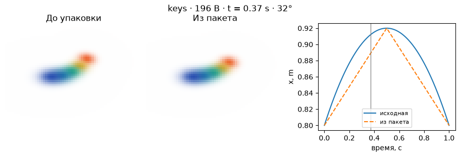
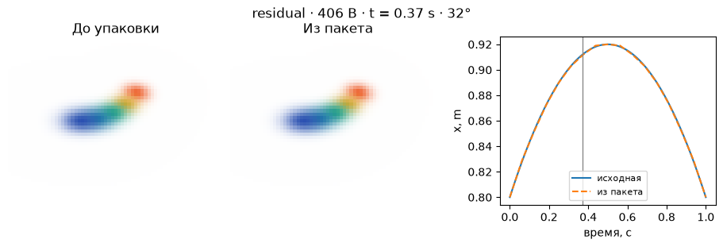

[Jupyter-ноутбук](../../notebooks/ru/lesson-29.ipynb)


# 29. Сколько весит секунда движения

[Программа курса](../../README_ru.md)

Цветная лента из урока 26 уходит в сторону и возвращается. Все пять пятен узнаваемы на протяжении движения. Незачем писать их цвет заново на каждом шаге. Сначала отделим внешний вид от траектории, затем посмотрим, какой изгиб теряется между редкими опорными кадрами.

```python
%matplotlib inline
from pathlib import Path
import sys
course = next(p for p in (Path.cwd(), *Path.cwd().parents) if (p / "compression_math.py").is_file())
if str(course) not in sys.path:
    sys.path.insert(0, str(course))
import json
import numpy as np
import matplotlib.pyplot as plt
from IPython.display import display
import compression_math as codec
import compression_demos as demos
from reconstruction import scores, benchmark
from splat_render import render_scene, orbit_camera
lang = "ru"
```

## Семнадцать положений, шестнадцать промежутков

Состояния записаны в моменты от нуля до одной секунды, включая оба края. Между 17 отметками остаётся 16 равных интервалов длиной $1/16=0.0625$ с. В одном состоянии у пяти пятен $5\cdot3=15$ координат. По четыре байта на float32 дают $15\cdot4=60$ байт на состояние. Все центры за секунду займут $17\cdot60=1020$ байт. У двоичного пакета `GSM1` есть ещё 16 байт заголовка: четыре буквы, способ кодирования и резервный байт, три двухбайтовых числа (число кадров, пятен и шаг опор), затем четыре байта цены кода. Итого 1036 байт.

Пакет хранит **только центры** на равномерной сетке. Порядок пятен, их постоянная форма, цвет и непрозрачность приходят из канонической сцены. Длительность тоже нужна для перевода номера кадра в секунды. Исходный JSON урока 26 уже содержит эту сцену, длительность и амплитуды. Мы берём его движение как эталон и исследуем другой способ доставки — таблицу центров для проигрывателя, которому закон движения заранее неизвестен. Для этого конкретного движения исходная формула особенно компактна.

```python
model, xyz = codec.motion_data()
packet = codec.pack_motion(xyz, mode='dense')
print('frames × identities × coordinates:', xyz.shape)
print('header + XYZ:', len(packet), 'bytes')
print('duration:', model['duration'], 's')
print('canonical, including starting centers:', len(codec.pack_static(model['canonical'], 'f32')), 'bytes')
```

```text
frames × identities × coordinates: (17, 5, 3)
header + XYZ: 1036 bytes
duration: 1.0 s
canonical, including starting centers: 288 bytes
```

## Опоры и линия между ними

При шаге 8 сохраняются кадры 0, 8 и 16. Три опоры по 60 байт плюс заголовок дают $16+3\cdot60=196$ байт. Чтобы узнать координату в кадре 2 между 0 и 8, сначала найдём долю пути $u=(2-0)/(8-0)=0.25$. Пусть у этой координаты опоры стоят в 0.10 и 0.50 м. Четверть пройденной дороги означает три четверти первого значения и одну четверть второго:

```math
\hat{x}=(1-u)x_0+u x_8=0.75\cdot0.10+0.25\cdot0.50=0.20\text{ м}.
```

Такой расчёт повторяется для каждой оси каждого пятна. Когда шаг не делит 16 нацело, последний кадр всё равно сохраняется. Например, шаг 6 даёт опоры 0, 6, 12 и 16. В последнем интервале знаменатель равен $16-12=4$, а не 6. Прямой отрезок экономит байты, но сглаживает искривление траектории. Ползунок времени двигает обе копии вместе. У ракурса своё управление. В веб-опыте доступен и JSON собственной сцены из урока 26.

```python
display(demos.codec_lab(29, lang))
```

```python
demos.motion_figure(lang, mode='keys', stride=8, time=.37)
plt.show()
```



## Поправка со знаком

В том же кадре истинное значение могло оказаться 0.236 м. Прогноз равен 0.20 м, значит ошибка прогноза $r=0.236-0.20=0.036$ м. Один шаг кода пусть соответствует $s=0.01$ м. В единицах кода поправка $r/s=3.6$, ближайшее целое — 4. После чтения координата равна $0.20+4\cdot0.01=0.24$ м. Осталось $0.004$ м ошибки. Для значения ниже линии поправка будет отрицательной.

Со знаком в байте помещаются целые от −128 до 127. Здесь диапазон сделан симметричным от −127 до 127. При шаге 0.01 м самая большая записываемая поправка равна $127\cdot0.01=1.27$ м. Без насыщения ошибка округления не больше половины шага. При очень маленьком шаге диапазон сужается, и большой остаток обрежется на границе. Опорные кадры не нуждаются в поправках. Для 14 остальных кадров уйдёт $14\cdot5\cdot3\cdot1=210$ байт. Вместе с опорами $196+210=406$ байт. Каждая поправка отсчитывается от соседних опор, так что ошибка одного промежуточного кадра не перейдёт в следующий.

```python
from deformation import scene_at
from compression_math import pose_with_centers
t, angle = .37, 32
cam = orbit_camera(angle, 55)
reference = render_scene(scene_at(model, t), cam, 65, 49)
for mode in ['dense', 'keys', 'residual']:
    data = codec.pack_motion(xyz, mode, stride=8, quantum=.002)
    track = codec.unpack_motion(data)
    pred = pose_with_centers(model['canonical'], codec.sample_track(track, t))
    error = scores(render_scene(pred, cam, 65, 49), reference)['mse']
    print(mode, len(data), 'B; MSE', round(error, 9),
          'clip decode ms', round(benchmark(lambda: codec.unpack_motion(data)), 4))
demos.motion_figure(lang, mode='residual', stride=8, quantum=.002, time=t, angle=angle)
plt.show()
```

```text
dense 1036 B; MSE 2.2e-08 clip decode ms 0.0054
keys 196 B; MSE 0.000584908 clip decode ms 0.0846
residual 406 B; MSE 2.8e-08 clip decode ms 0.0983
```



## Момент между кадрами

Время 0.37 с попадает на позицию $0.37\cdot16=5.92$. Проигрыватель смешивает центры декодированных кадров 5 и 6 с долями 0.08 и 0.92. Эталонная модель из урока 26 умеет считать исходную кривую прямо при 0.37 с. Даже файл со всеми 17 кадрами даст небольшую ошибку между ними. Ракурс 32° показывает, как эта разница выглядит для другой камеры. MSE здесь сравнивает с исходным **движением модели**, а не с фотографиями обучающего набора. Скорость в таблице — именно декодирование всего клипа. Быстрые вызовы в браузере замеряются сериями, затем время делится на число вызовов.

**Опыт.** Останется ли выгода от поправок при шаге опор 1? Что произойдёт с размером?

<details>
<summary>Разбор</summary>

Каждый из 17 кадров стал опорным. Промежуточных кадров ноль, значит байтов поправок тоже ноль. Получится тот же размер $16+17\cdot60=1036$ байт, что и у полной записи. Ошибка между моментами измерения по-прежнему зависит от частоты записи.

</details>
